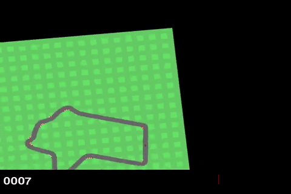

# CarRacing
Self Driving Car Game implemented with DQN (Reinforcement Learning)



## Installation

Requires Python 3.10 or newer.

```bash
python3 -m venv .venv
source .venv/bin/activate
pip install --upgrade pip
pip install -r requirements.txt
```

## Play the game yourself

```bash
python -m gymnasium.envs.box2d.car_racing
```

## Watch the trained agent play

```bash
python ./code/train_dqn.py --play ./runs/baseline/best.pt --play-episodes 10
```

## Train your own agent
```bash
python ./code/train_dqn.py --run-name my_run --num-envs 4 --hours 2
```

### Related papers
- [Playing Atari with Deep Reinforcement Learning](https://arxiv.org/abs/1312.5602) (Mnih et al., 2013): the original DQN paper.
- [Human-level control through deep reinforcement learning](https://www.nature.com/articles/nature14236) (Mnih et al., 2015): the network architecture used here.
- [Deep Reinforcement Learning with Double Q-learning](https://arxiv.org/abs/1509.06461) (van Hasselt et al., 2015): the Double DQN update used here.
